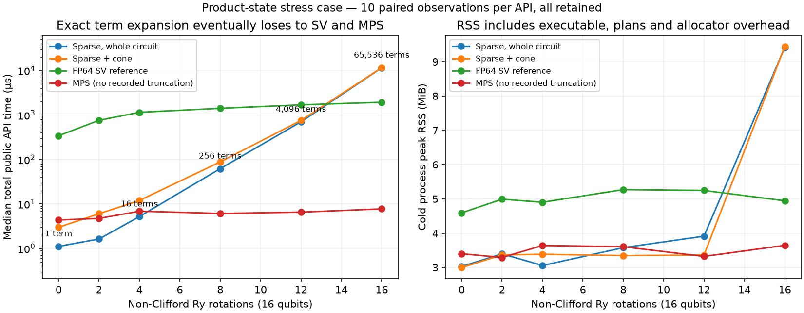

# P7-06: exact near-Clifford expectations by sparse Pauli propagation

Issue #548 adds an opt-in CPU expectation engine to `aleph-stab`, alongside the tableau backend. It computes Hermitian Pauli-sum expectations for unitary circuits starting in |0…0>, with f64 arithmetic and **no intentional coefficient truncation**. It does not produce amplitudes, samples, arbitrary initial states, GPU execution or approximate pruning.

## Algebra and supported semantics

The operator moves backwards through the circuit, `O <- U† O U`. Packed X/Z supports represent canonical Hermitian tensor products: `(x,z)=(0,0),(1,0),(0,1),(1,1)` denote I,X,Z,Y. Real coefficients carry signs, including Clifford Y phases; the key itself never carries an ambiguous global phase.

Clifford conjugation maps each key bijectively to a signed key and creates no branches. For `R_A(theta)=exp(-i theta A/2)`, a commuting Pauli is unchanged. An anticommuting Pauli becomes `cos(theta) P + i sin(theta) A P`; local Pauli multiplication determines the real sign of the second term. For example, Rx maps Y to `cos(theta)Y - sin(theta)Z`, and Rz maps X to `cos(theta)X - sin(theta)Y` in this **backwards** convention. The untruncated update is [Begušić, Hejazi and Chan, section 2, equation (3)](https://arxiv.org/pdf/2306.04797); this implementation does not apply that paper's perturbative-order approximation.

Supported gates:

- H, X, Y, Z, S, Sdg; CNOT, CZ, SWAP, iSWAP and iSWAP†.
- One generic external control on X, Y or Z. Other controlled gates are rejected.
- Finite concrete Rx/Ry/Rz/Phase and T/Tdg (Z rotations up to irrelevant global phase).
- Barriers preserve the planner's order but are not physical gates. Tiled blocks are flattened in their original gate order.

A ZZ rotation can be expressed as CNOT–Rz–CNOT using the supported IR; there is no new ZZ gate variant. Generic matrices, U3, controlled rotations, multi-controls, Toffoli/CCZ, fused diagonal polynomials, measurement and reset receive explicit errors, even if disjoint from the observable or canceled by zero coefficients. Unsupported gates are not silently classified, approximated, or sent to another backend. No nonzero/noisy initial-state input is offered.

Exact represented multiples `theta == k * (pi/2)` with integer |k|≤1,000,000 use the exact 0/±1 conjugation table. Nearby angles are **not** snapped by tolerance. All other angles use f64 sine/cosine. Only coefficients exactly equal to zero after arithmetic disappear; nonzero values such as 1e-200 are retained. This is untruncated numerical propagation, not symbolic exact arithmetic: ordinary roundoff, underflow and accumulated cancellation error remain possible. Non-finite coefficient sums, norms or final expectations are errors, never clipped values.

Keys merge by deterministic in-place sorting and addition after a rotation; Clifford maps need no merge because they are bijective. The zero-state expectation is the sum of coefficients with no X support: I/Z products contribute +1; every product with X/Y contributes zero. Terms are not removed early merely because their *current* zero-state expectation vanishes; earlier gates can change it.

## Shared query contract and limits

`SparsePauliQuery::compile(circuit, observable, options)` validates all supported instructions and observables before pruning. Observable qubits are logical indices, including relabeled IR. `execute()` returns the weighted sum and diagnostics, not a state.

With `use_cones=true`, P7-03's `ExpectationQueryPlan` supplies compact circuits/maps, analytic identity terms and groups of observables with identical retained circuits/support. Each group propagates its sum; groups execute sequentially. With cones disabled, the whole circuit is propagated with observables mapped into physical IR indices. This makes both approaches directly comparable without changing the input-state or expectation convention. Coefficient L1/L2 diagnostics describe the concatenation of final group vectors and analytic entries; they are not a global observable norm or an error bound when different groups overlap.

`SparsePauliOptions` defaults to 65,536 candidate terms and 64 MiB sparse workspace. `max_terms` applies to the input population and to **pre-merge candidates**, conservatively rejecting some work whose later cancellations could fit. Every rotation first counts its exact prospective splits, checks the candidate count and simultaneous workspace, then allocates. A rejected query returns `Terms { required, limit }` or `Memory { required_bytes, budget_bytes }`; no partial expectation is returned and no approximate fallback is automatic.

The workspace bound covers both term-vector capacities plus packed key payloads while old and new populations coexist. For `w=ceil(active_qubits/64)` and a term header of `size_of::<Term>()`, it accounts for:

```
(old_vector_capacity + candidate_count) * term_header_bytes
+ (old_live_count + candidate_count) * 2*w*8
```

Initial conversion is checked before packed-key allocation. The cap excludes caller-owned circuit/observable data, compiled plans, allocator metadata, runtime/library stacks and process overhead. It is a payload bound, **not** an RSS guarantee. Process peak RSS is measured separately. Arithmetic overflow yields a structured memory error. Limits can be raised explicitly; raising them does not guarantee physical memory availability.

Diagnostics include active width, retained gates, peak merged terms/candidate terms, peak workspace payload, actual branching-rotation count, splits, key merges, final coefficient norms and planning/execution time. Expansion count depends on observable support and commutation/cancellation, not simply total T/rotation count.

## Correctness evidence

- 128 property-generated circuits (2–6 qubits, up to 39 gates) compare both cone modes against full FP64 SV to 1e-10, including signed multi-term sums, Y factors, negative rotations, T/Tdg, native/external Pauli controls, iSWAPs and relabeled qubits.
- Exhaustive two-qubit checks cover all 16 Pauli observables and all 36 products of the six Pauli eigenstates for each tested conjugation. These product density matrices span the operator space, checking signs/direction against the SV gate matrices rather than only zero expectations.
- Clifford-only output agrees with the existing tableau conventions without branching; exact Clifford-angle limits, nearby-angle branching, inverse gates and duplicate-key cancellation are tested.
- Invalid/unsupported disjoint instructions, non-finite/duplicate observables, malformed arity-zero fused IR, empty/zero-qubit queries, numerical overflow, term/workspace refusal and retention of 1e-200 coefficients are tested.
- A genuinely global 128-qubit GHZ-phase observable `X⊗128` has a 128-qubit cone yet only two propagated terms. Its independent analytic reference is `cos(.37)` from `( |0…0> + exp(i*.37)|1…1> ) / sqrt(2)`. A six-qubit instance also agrees with full SV. This validation allocates no 2^128 state.

Final local release stabilizer suite: **84 passed**, 3 existing ignored; **1 doc test passed**. Workspace all-target beta Clippy and rustfmt passed. The recorded Linux suite and public query input smoke tests are retained with the benchmark receipts. Review is manual self-review, not an external code-review service.

## Useful regime and measured failure cases



The predeclared corpus covers Clifford-only GHZ, a single non-Clifford phase on a global GHZ observable, a 128-qubit shallow brickwork local query, 64 canceling rotations on one qubit, and product-state branching sweeps (0/2/4/8/12/16 Ry rotations). Parameters and topology are in `examples/support/sparse_workloads.rs`; all APIs receive the same original circuits/observables. Product/GHZ cases have independent analytic references; local128 is checked against P7-03 compact FP64 SV.

Median paired **total public API** time in microseconds (10 observations each, all retained):

| Fixture | Peak terms | Sparse, no cone | Sparse + cone | SV reference | MPS |
|---|---:|---:|---:|---:|---:|
| ghz18-clifford | 1 | 3.34 | 24.58 | 22,051.49 | 814.02 |
| ghz18-rotation | 2 | 4.05 | 25.55 | 21,786.51 | 907.43 |
| ghz128 | 2 | 12.59 | 87.51 | — | 41,308.62 |
| local128 | 42 | 62.69 | 204.43 | 168.35 (compact) | 1,316.43 |
| cancel16 | 2 | 19.55 | 62.13 | 9,802.68 | 12.03 |
| product16-k0 | 1 | 1.11 | 2.99 | 342.15 | 4.36 |
| product16-k2 | 4 | 1.63 | 6.03 | 759.64 | 4.73 |
| product16-k4 | 16 | 5.20 | 11.97 | 1,147.91 | 6.87 |
| product16-k8 | 256 | 62.21 | 88.23 | 1,411.48 | 6.11 |
| product16-k12 | 4,096 | 702.82 | 753.54 | 1,693.96 | 6.54 |
| product16-k16 | 65,536 | 11,527.64 | 11,604.16 | 1,937.25 | 7.75 |

The SV comparator is the existing f64 AoS `NaiveSvBackend` on the original unfused IR, matching the P7-03 reference path, **not** a claim against every optimized compiler/backend or Aer. MPS uses bond cap 128; observed maximum bonds are 1/2/4 and discarded weight is zero except local128 (~3.6e-32). The local128 SV entry is a six-qubit exact cone; no full 2^128 allocation is attempted. GHZ128's cone is genuinely 128 qubits, with an analytic reference instead of dense SV.

Conclusions from these fixtures:

- Small observable branching can make large/global queries cheap: GHZ128 needs two terms and 192 bytes of peak sparse payload, with ~12.6 µs total no-cone query time and ~3.63 MiB cold-process RSS. This does not imply arbitrary128-qubit simulation. The MPS comparison includes its existing routing costs for the specified long-range star circuit.
- Term growth can make sparse propagation the wrong algorithm even on an **unentangled** state. Product16-k16 reaches 65,536 terms/4.5 MiB payload and ~9.42 MiB RSS, versus ~4.95 MiB SV and ~3.64 MiB MPS RSS. Its ~11.53 ms sparse time is about6× the named SV reference and roughly1,500× MPS. Keeping this adverse case is essential; no automatic routing is justified from the low-branch wins.
- Cone extraction is not a free improvement. Local128 reduces active width 128→6 and sparse payload 4,608→3,456 bytes, but planning increases paired total time62.7→204.4 µs. The existing compact-SV query (~168.4 µs) also beats sparse+cone here. On GHZ128, preprocessing adds cost while retaining the whole 128-qubit support.
- Rotation count alone does not predict growth: the 64 rotations in cancel16 peak at two terms/four candidates, while 16 rotations in the product stress case produce 65,536 terms. Exact merging/commutation and observable support matter. Both explicit modes remain available; there is no inferred “safe magic-count” router.

Criterion independently measures public compile+execute/allocation/release without the example's JSON adapter (µs; point estimate, raw confidence intervals retained):

| Fixture | Sparse | Sparse + cone | SV | MPS |
|---|---:|---:|---:|---:|
| ghz18-rotation | 2.192 | 15.395 | 22,340.002 | 722.139 |
| local128 | 57.709 | 189.406 | — | 1,197.549 |
| product16-k4 | 2.332 | 4.577 | 1,193.352 | 3.216 |
| product16-k12 | 723.108 | 734.286 | 1,719.499 | 3.415 |

Example paired and Criterion tiers have different instrumentation and Rust profiles (release versus bench with line tables); do not interchange their microsecond costs or combine ratios across tiers. These are comparisons for a **new instrument**, not a before/after speedup from modifying an existing backend.

## Measurement and provenance

Authorized Linux CPU run on dual Xeon Silver 4114 (40 logical CPUs), Rust 1.96.0, CPU 3 affinity, Rayon=1, sibling 23 monitored. Services and CI remained running. Each case/API gets an untimed correctness warmup, then five forward/reverse paired blocks. All 430 timed outputs and 43 separate cold-process RSS outputs agree with analytic/FP64 references to 1e-10. RSS is one fresh process per case/API, not repeated-isolated-system memory statistics. Criterion uses 20 samples, 500 ms warmup, 1 s collection target and retains outliers/actual extended collection; raw samples and estimate intervals are archived.

Coarse load accounting found no extra CPU 3 occupation or sibling 23 activity during the 1.505 s paired campaign. Across 104.738 s of Criterion/analysis it estimated ~1.39% additional CPU 3 occupation and ~0.019% sibling occupation. This cannot exclude sub-sample interruptions, shared-cache/frequency effects or prove isolation. These fixtures establish useful/adverse regimes, not a universal hardware speed guarantee.

The first capture is excluded for **source/binary provenance**, not performance: a tar update preserved older source mtimes and Cargo reused a stale benchmark executable (`fresh:true`). A mismatch between paired and Criterion tiers exposed it. The full invalid capture is retained separately. Freshness guards blocked attempts that had not established an explicit rebuild; the final runner cleans the release profile, refreshes hash-verified source timestamps, builds example/bench before tests and verifies `fresh:false` for **both executable and library** in each compiler artifact stream before the single valid recapture. All final source hashes match implementation commit `da7bca3`.

[Raw measurements, build provenance, validation and excluded audit](data/p7-06-sparse-pauli/README.md) are committed. The final Linux release suite also passes 84 tests plus 1 doc test (3 existing ignores). The QASM file-input smoke passes on both Mac and Linux. Public supported inputs and resource failures are unchanged between tested source and final documentation/receipt commits.

## Reproduction

```sh
cargo test --release -p aleph-stab
cargo run --release -p aleph-stab --example sparse_expectation
# P7-03-style QASM + one weighted Pauli string per text line:
cargo run --release -p aleph-stab --example sparse_expectation -- circuit.qasm observable.txt 65536 67108864
# Same expectation without cone preprocessing:
cargo run --release -p aleph-stab --example sparse_expectation -- circuit.qasm observable.txt 65536 67108864 --no-cones
# All descriptive paired API observations / one cold process:
RAYON_NUM_THREADS=1 cargo run --release -p aleph-stab --example sparse_expectation -- --audit
cargo run --release -p aleph-stab --example sparse_expectation -- --one product16-k16 sparse
cargo bench -p aleph-stab --bench sparse_expectation
```

A Pauli-sum file for a two-qubit GHZ-phase circuit can contain `1.0 XX` and `0.3 ZZ`; the result is `cos(.37)+.3`. A limit of eight candidate terms rejects the tested eight-rotation product fixture when the next population would be 16, before allocating that expansion. The public example prints resource diagnostics; the Rust error variants distinguish exhaustion from unsupported semantics.
