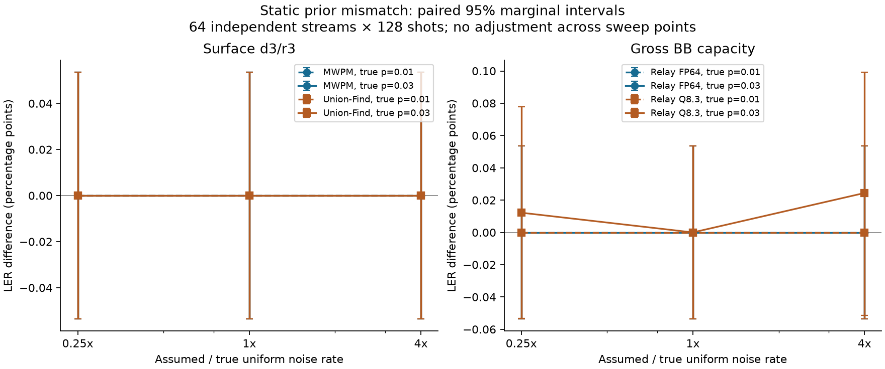
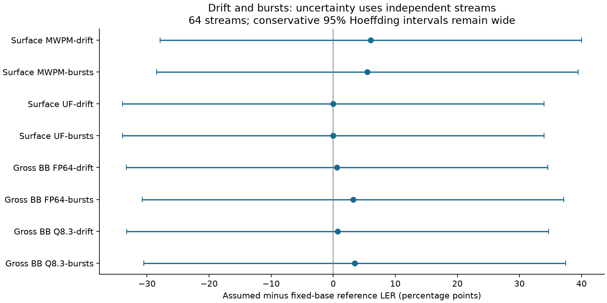

# P7-04 — Decoder robustness under mismatch, drift and bursts

Issue [#546](https://github.com/aleph-sim/aleph/issues/546).

`run_robustness` is an opt-in paired experiment instrument. It separates the generating DEM
from two immutable decoder models, reconstructs the same original fault set for both, and
counts logical mismatch independently of syndrome validity/non-convergence. Existing ordinary
and rare-event harnesses are unchanged.

```rust
use aleph_qec::*;
let generating = DetectorErrorModel::parse("error(0.2) D0 L0")?;
let assumed = DetectorErrorModel::parse("error(0.01) D0 L0")?;
let a = WitnessDecoder::new(&assumed, DecoderSpec::Mwpm)?;
let reference = WitnessDecoder::new(&generating, DecoderSpec::Mwpm)?;
let opts = RobustnessOptions {
    streams: 64, steps: 128, seed: 546, confidence: 0.95, witness_limit: 2,
};
let result = run_robustness(&generating, &NoiseProcess::Static, &a, &reference, &opts)?;
```

## Model identity and experimental unit

Compatibility requires equal detector/observable dimensions and identical **ordered** original
mechanism supports, logical masks and correlated `^` components. Probabilities alone may differ.
Equal matrix dimensions are insufficient. Index identities still come from the caller's model;
the tool cannot infer an external circuit's semantic detector renaming. Both models undergo
canonical DEM round-trip validation. Results retain full generating/assumed/reference DEMs,
their SHA256 hashes, both decoder configurations/disorder seeds, process parameters and budgets.

One time index is one **complete DEM shot**: for a surface d3/r3 fixture it contains the whole
three-round experiment. Temporal bursts correlate successive shots, not internal circuit rounds
or a persistent quantum state across shots. Affected indices are DEM mechanisms, not physical
circuit-fault locations. This instrument does not add missing circuit correlations or physical
location provenance to a DEM.

The campaign has predeclared independent streams and a fixed shots-per-stream endpoint.
The total is limited to two million shots, and each stream to 100000. Two scored decoder
predicates run per shot. Available fixed-point diagnostics may do additional internal decoding;
`decoder_calls` counts scored predicates, rather than BP sweeps or hidden diagnostic passes.
Timing fields include that diagnostic work. No adaptive stopping, fitted refresh, or controller
is implemented. The example builds the reference decoder against the base generating DEM;
it is matched for static runs, and **fixed base priors** under drift/bursts, not an oracle
that sees future generating probabilities.

## Processes and random streams

- `Static`: original independent Bernoulli mechanisms. Stream zero uses exactly the ordinary
  DEM sampler's seed/shot coins, including p=0/p=1 mechanisms.
- `LinearDrift`: linearly interpolate each original probability from the base value at t=0
  to a predeclared endpoint at t=steps-1; one-step streams use the base. Equal endpoints retain
  base values without rounding drift. Shots are independent but not identically distributed.
- `MarkovBurst`: latent state starts inactive before t=0. Before every shot, an inactive
  state activates with `onset`; an active state recovers with `recovery`. Active shots multiply
  selected mechanism probabilities by `multiplier>=1`, capped at one. Given state, mechanism
  coins remain independent. The common latent state causes cross-mechanism and temporal
  dependence. A strength-one burst consumes the same latent coins but preserves ordinary faults.

For onset a and recovery b, `q[t]=(1-q[t-1])*a+q[t-1]*(1-b)` with q[-1]=0. Where a+b>0,
stationary active probability is a/(a+b), lag-one state correlation eigenvalue is 1-a-b,
and active-run duration is geometric with mean 1/b when b>0. Finite streams start out of
stationarity and right-censor the last run. Reports compare finite-horizon occupancy, starts
and adjacent-active pairs to this recurrence, not blindly to stationary values.

Each independent stream has a versioned seed map; stream zero keeps the original campaign
seed. Latent transitions use a separate StdRng derived from the stream seed; shot mechanism
coins use the existing `(seed,time)` SplitMix64/StdRng mapping. Scheduling and worker count do
not change shots. A burst prefix does not depend on future stream length or other streams.
Drift's entire deterministic endpoint schedule is declared beforehand; it is not learned from
future shots. Ordinary floating-point and pseudorandom-generator assumptions remain.

## Confidence bounds and paired comparison

Each reported interval is **marginal** at the requested confidence, not simultaneous across
all curves, configurations or three estimands. Nothing treats validity as logical failure.

For static iid runs, marginal rates use equal-tailed Clopper–Pearson bounds. For paired
assumed-minus-reference difference, count `worse` (assumed fails, reference succeeds) and
`better` (reverse). Bound each discordant probability with alpha/2 error allocation and
subtract endpoints outward: `[lower_worse-upper_better, upper_worse-lower_better]`.
Bonferroni supplies the claimed coverage without assuming the paired outcomes are independent.
Zero discordances still give a non-degenerate interval; zero measured difference does not
prove identical classifiers.

For drift and bursts, the independent unit is a **whole stream**. Each stream's error mean is
in [0,1], and each paired difference in [-1,1]. [Hoeffding's inequality, Theorem 2 (1963)](https://www.cs.rpi.edu/academics/courses/spring06/random/hoefding.pdf) gives radius
`sqrt(log(2/alpha)/(2*streams))` for a marginal mean and twice that for a paired difference.
Bounds are clipped to their parameter domains. This tolerates arbitrary within-stream
correlation and avoids invalid binomial intervals over burst-correlated shots. It is deliberately
conservative: at 64 streams and 95%, the marginal radius is about 0.170 and paired radius
about 0.340. More shots inside a fixed number of streams do not shrink that guaranteed radius.
The offline coverage example analytically marginalizes the tiny latent process and enumerates
fault sets; every final interval is retained, including uninformative ones.

## P7-01 witnesses

A v3 `FailureWitness` retains assumed decoder priors in `dem`, plus `RobustnessV1` sampling
provenance: complete generating DEM, process JSON, campaign seed, stream identity, full length,
absolute time and burst state. The process is stored as JSON text to preserve the existing
`WitnessSampling: Eq` contract. Import checks schema/version, model compatibility, stream seed,
reconstructs the latent prefix and fault set, and verifies original/current source outcomes.
Replay work is bounded by the same 100000-step limit. Capture reuses the scored outcome and
does not add a source predicate call. Only failed assumed-decoder shots are retained, bounded
by the global witness limit.

v1 ordinary and v2 stratified JSON/golden bytes remain unchanged. Existing minimization works
with v3: original stochastic provenance stays intact; reduced fault sets are counterfactual
subsets, not new random samples. Existing signatures group the same assumed decoder/model and
fault set; they are not complete generating-process identities. Both the source model and
provenance must be consulted when interpreting a grouped artifact.

## Reproduction and validation

```sh
cargo test -p aleph-qec --test robustness --test witness --test stratified
cargo run --release -p aleph-qec --example decoder_robustness -- OUTDIR 64 128
python scripts/python/check_decoder_robustness.py OUTDIR/summary.json
cargo run --release -p aleph-qec --example robustness_coverage -- coverage.json 1000
cargo bench -p aleph-qec --bench robustness
cargo run --release -p aleph-qec --example decoder_witness -- replay WITNESS.json
```

Python oracle requirements: NumPy, SciPy, Stim, PyMatching. It independently verifies all
interval endpoints, finite-horizon burst statistics and tiny-model exact paired expectations.
The tiny model requires explicit minimum-weight boundary edges: the default PyMatching DEM
importer merges same-endpoint/different-logical-mask mechanisms differently. This known policy
difference is retained explicitly rather than reported as oracle agreement.

Static fixtures sweep true p=0.01/0.03 and assumed-rate factors 0.25/1/4. Surface also sweeps
physical data/measurement bias (4x/0.25x). BB uses its code-capacity prior parameter. Dynamic
fixtures use a base p=0.01, fixed alternating-mechanism assumed-prior factors 0.25/4, drift
endpoints 4x base, or bursts with onset 0.05, recovery 0.2, multiplier 8 on even original
mechanisms. These affected groups are synthetic; no unsupported physical bias label is applied.
Surface compares MWPM and unweighted Union-Find; Gross BB compares floating and Q8.3 Relay
(6 legs x10 sweeps, full schedule, fixed disorder seed). All pairs see identical generated shots.

Runtime includes model validation, generation, interval construction and bounded capture;
prebuilt decoder setup is recorded separately. Decode order is assumed then reference, so
per-decoder durations are descriptive and may have cache/order effects. Criterion compares
512 scored predicates in the paired static harness with two ordinary 256-shot runs, plus
process-generation costs. No throughput optimization or unconditional speedup is claimed.

## Fixed CPU campaign results

Dual Xeon Silver 4114, CPU3 affinity, Rayon1. Each case uses 64 streams x128 shots =8192
paired samples (16384 scored predicates). There are 36 surface/BB cases plus one tiny control,
all retained. No services were stopped. Total campaign runtime was 82.18 s; measured external
CPU3 interference about 1.24%, SMT sibling23 activity 0.024%. Timings remain descriptive.

| Case | Assumed LER | Reference LER | Difference, percentage points | 95% paired interval, percentage points |
|---|---:|---:|---:|---:|
| Surface MWPM p=.01, data/meas bias 4x/.25x | 1.4160% | 1.2939% | +0.1221 | [-0.1289, +0.3719] |
| Surface MWPM p=.03, data/meas bias 4x/.25x | 10.6567% | 9.7778% | +0.8789 | [+0.202, +1.555] |
| Surface unweighted UF p=.03, same bias | 10.8154% | 10.8154% | 0 | [-0.0535, +0.0535] |
| Gross BB fixed Relay p=.03, assumed 4x | 0.2197% | 0.1953% | +0.0244 | [-0.051, +0.099] |
| Surface MWPM drift | 13.9038% | 7.8613% | +6.0425 | [-27.910, +39.995] |
| Surface MWPM bursts | 10.1929% | 4.6997% | +5.4932 | [-28.459, +39.446] |
| Gross BB floating Relay bursts | 3.6621% | 0.4517% | +3.2104 | [-30.742, +37.163] |

The p=.03 physical data/measurement mismatch is resolved by its **marginal** paired interval;
this exploratory sweep has no multiple-comparison adjustment. Uniform-rate scaling produced
identical observed MWPM and floating-Relay logical decisions in the scoped fixtures. This does
not establish general prior robustness. Unweighted Union-Find intentionally ignores priors and
serves as a no-effect control. Fixed-point quantization can change decisions under uniform
prior scaling, but the observed small differences here are not resolved by the intervals.

At BB p=.01 there are no observed logical failures in these samples; positive CP upper limits
remain in the receipts. Burst/drift point estimates suggest degradation under the synthetic
nonuniform assumed priors, but 64-stream Hoeffding intervals include zero. More independent
streams, not unjustified iid shot counting, are needed for a precise dynamic comparison.
For example, floating Relay BB p=.03 has 15 logical failures but 11 invalid decisions at the
matched setting: those quantities are stored separately, not substituted for one another.

The tiny heterogeneous model has exact rates 0.405 (wrong assumed priors) and 0.1925
(reference), paired difference 0.2125. Independent PyMatching enumeration with explicitly
aligned edge semantics agrees. Stim's independent 100k-shot control checks observable parity.
Across 1000 fixed coverage seeds, static marginal coverage is 946/1000 for each rate
(coverage's own 95% interval [0.9301,0.9592], compatible with 0.95); paired coverage is
995/1000 ([0.9884,0.9984]). Drift and burst Hoeffding coverage is 1000/1000 for each estimand
([0.9963,1]), reflecting conservative, broad intervals rather than precise calibration.

Criterion means: two ordinary 256-shot runs 770.94 us; paired static instrument 1656.18 us
(512 scored calls each), about 2.15x overhead including extra interval/diagnostic/provenance
work. Generating a 256-shot trace costs 777.66 us static, 857.97 us drift, 772.91 us bursts.
These are feature-cost observations, not an optimization claim; no matched disabled-hot-path
change is introduced. Criterion external CPU3 interference was about 1.27% and sibling activity
0.043%; raw samples and outliers are preserved.

Complete local release run: 257 tests plus 9 doc tests passed, with 22 existing ignores.
The final added causality test also passes (7 robustness tests); Linux final focused suites
pass 7 robustness +8 witness +10 stratification checks. Workspace beta Clippy and fmt pass.
All 31 exported witnesses replay on both Linux and Mac. Source patches and full receipts:
[`../perf/data/p7-04-decoder-robustness/`](../perf/data/p7-04-decoder-robustness/README.md).




