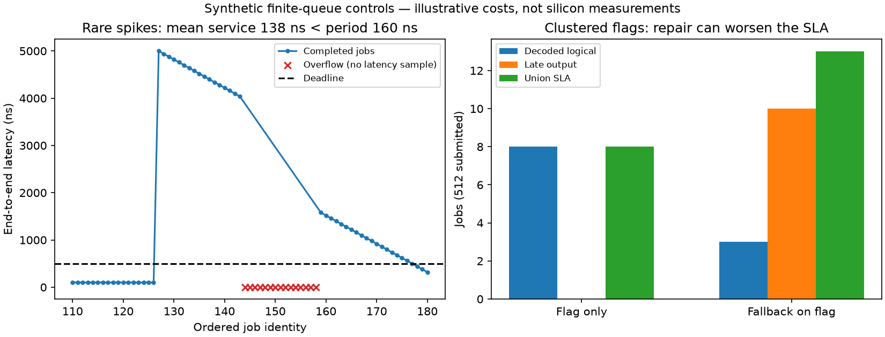

# P7-05: deadline-aware decode trace replay

Issue #547 adds an experiment instrument, not a faster decoder or a closed-loop quantum controller. Ordered timing/outcome tuples now feed a deterministic finite FIFO with separate primary and fallback resources. This exposes losses that a mean decode time or a decoded-error rate alone hides.

In the synthetic rare-spike control, mean service is 138.281 ns against a 160 ns arrival period, yet 45/512 jobs overflow and 106 completed outputs are late. In the clustered-flag control, fallback reduces decoded logical mismatches from 8 to 3 but increases the explicit union SLA failure count from 8 to 13. These costs are constructed examples, not hardware measurements.



## Contract and resource model

`DecodeTrace` version 1 carries ordered job IDs, per-stream consecutive sequence numbers, arrivals, optional relative deadlines, commit prerequisites, configuration, an input SHA-256, timing provenance, validity and optional logical mismatch for each actual primary/fallback decision. `None` logical outcome means unknown. Timing sources are explicitly `Synthetic`, `GoldenModelHost` or `MeasuredSilicon`; the implementation cannot authenticate a producer's provenance claim. Service is nanoseconds or cycles plus an explicit nonzero clock, converted with integer ceiling. Time addition and conversion overflow are errors. Unknown JSON fields, malformed sequence/dependency chains and unsupported versions are rejected.

A job is either an independent complete block or a dependent streaming window. Streaming producers must document window/commit lengths in configuration and capture timings/outcomes under the declared `streaming_policy`. Each later window requires its immediate predecessor's final correction commit. Replaying another fallback policy is rejected: its downstream prerecorded syndrome history would no longer be established. A missing/discarded prerequisite cancels descendants. A fallback queue overflow that keeps a primary correction also cancels streaming descendants conservatively because the captured fallback history changed. Independent blocks can compare flag-only and fallback without changing later input history. No independent resampling or shuffling is performed.

Resource semantics:

- Primary worker count and waiting capacity are configurable; queue capacity excludes running jobs. FIFO admission drops new work on overflow. A blocked dependent head is never bypassed, including by another stream.
- Flag-only emits the actual primary result. Fallback-on-flag sends invalid primary decisions to a separate FIFO/resource, using the conditional time and outcome recorded from that same input/primary output. Missing fallback data is an error. A full tail queue either keeps primary or drops the job, explicitly configured.
- Ingress and egress occupy the primary resource; fallback transfer and its egress occupy the fallback resource. There is no separate pipelined DMA/interface server in this MVP. Fallback releases the primary worker; dependent windows still wait for the final commit.
- All existing completions at a timestamp release resources before admissions. Existing tail waiters dispatch first, then primary completions, then fallback completions; original input index breaks stage ties. Existing primary waiters precede new arrivals. Newly started zero-cost work completes atomically before the next admission, preventing artificial pressure at capacity zero.
- Output at exactly the deadline is on time; later output is late. Running work always completes: `CommitLate` emits it, `DiscardLate` withholds it. No preemption benefit is invented. Commit usability follows this configured disposition, not the logical-truth oracle.

Validation limits are 100,000 jobs, 1–1,024 workers per resource and 0–100,000 waiting slots. They bound replay bookkeeping, not a hardware capability.

## Metrics and denominators

`ReplayResult` retains each terminal disposition and queue levels after stable timestamps. Submitted work is conserved across committed, discarded-late, primary-overflow, fallback-overflow-drop and dependency-canceled dispositions. Tail-overflow events also include KeepPrimary, so they are not an additional disjoint terminal category.

Waiting/service/end-to-end distributions use nearest-rank p50/p95/p99/max. Primary wait includes every job that starts primary; fallback wait includes every job that starts fallback. Service sums occupied primary and conditional tail costs, excluding queue waits. Service/end-to-end distributions include completed outputs (including discarded-late), **not overflow/canceled jobs**. Always inspect their counts beside loss counters: fewer surviving jobs can make latency or decoded-error figures look better.

Queue mean integrates primary waiting occupancy over the finite horizon from first arrival through last terminal/arrival, including drain. Utilizations divide occupied resource time by that horizon times worker count; throughput counts committed corrections per second. Empty/zero horizons report no rate/utilization. Max primary and fallback waiting occupancy is retained separately. Startup/drain effects mean finite-trace utilization need not equal the infinite stationary offered load.

Flags, final invalid decisions, completed deadline misses, primary overflow, fallback overflow and decoded logical mismatches are separate. Decoded error uses the known completed logical-outcome denominator, including discarded outputs. Dropped jobs have no decoded outcome, never an assumed successful correction.

`DecodedLogicalOnly` counts known mismatches and reports unknowns. `LogicalOrLateOrMissing` counts a job once if its correction is missing, its completed output is late, or its known decoded result is wrong; unknowns remain explicit otherwise. This is an operational SLA definition, **not** evidence that every late correction causes a physical logical failure. Ordered/correlated trace counts are descriptive; no IID confidence interval is inferred.

## Existing Q4/Q7 adapter and timing provenance

Existing [Q4](../perf/qec-q4-realtime.md) and [Q7-07](q7-07-nonconvergence-policy.md) reports contain aggregate latency/error data, insufficient to reconstruct the joint ordered input/service/flag/logical distribution. The example therefore adapts Q7-07's existing native fixed-point golden decoder and OSD implementation, rather than splicing aggregate latencies onto unrelated outcomes or changing RTL.

The saved campaign uses Gross [[144,12,12]], one circuit-level round, uniform noise p=.007, 2,048 shots from seed 2024. FixedRelayBp uses 6 legs × 10 iterations, gamma=(-.3,.9), disorder seed 0x5E1A4B9C, 8 message bits/3 fractional bits. Full-budget and early-exit policies process the same ordered inputs with a shared input hash. Each primary host duration includes `decode_fixed_soft` and correction extraction. Each invalid shot's actual OSD0 fallback consumes that primary soft result; its timed region includes OSD, validity checking and correction extraction. Successful shots do not have fabricated fallback data.

Host: Linux x86_64, dual Xeon Silver 4114 (40 logical CPUs), Rust 1.96.0, CPU3 affinity, Rayon=1. Capture includes first-use effects and runs full before early, without ABBA blocks. These are descriptive host service traces, not a causal decoder speedup benchmark, board timing, or a 1 µs hardware throughput claim. Services and CI remained running. Recorded coarse accounting found no additional CPU3 occupation during the 6.017 s capture and no sibling23 occupation; this does not exclude interrupts, shared-cache/frequency effects or sub-sample interference.

The shared early-primary mean is 339,641 ns. Both policies replay the same arrival periods: 679,282 / 339,641 / 169,820 ns, with deadlines five periods, 1/2 primary workers, queue32 and one fallback worker/queue8. Ingress1 µs, egress1 µs per service and fallback transfer10 µs are **sensitivity assumptions**, explicitly stored in every config; they are not measured host-interface/board costs. All cases use KeepPrimary on tail overflow, CommitLate and the explicit union SLA. No tuple is independently shuffled. Separate deadline sensitivity at the fixed near-load period uses 2/5/10 periods, reusing recorded service tuples without recapture.

## Recorded results

Selected early-exit cases (all 2,048 submitted, no primary drops except the near/1-worker rows):

| Arrival period / workers | Policy | Committed | Late | Primary drops | Decoded mismatches / known | Union SLA failures |
|---|---|---:|---:|---:|---:|---:|
| 679,282 ns / 1 | Flag only | 2,048 | 4 | 0 | 56 / 2,048 | 58 |
| 679,282 ns / 1 | Fallback | 2,048 | 7 | 0 | 9 / 2,048 | 14 |
| 339,641 ns / 1 | Flag only | 1,988 | 1,692 | 60 | 55 / 1,988 | 1,752 |
| 339,641 ns / 1 | Fallback | 1,988 | 1,692 | 60 | 9 / 1,988 | 1,752 |
| 339,641 ns / 2 | Flag only | 2,048 | 72 | 0 | 56 / 2,048 | 74 |
| 339,641 ns / 2 | Fallback | 2,048 | 74 | 0 | 9 / 2,048 | 74 |

Fallback helps the low-load SLA, but repairing decoded errors alone does not repair a saturated primary queue. At near load/2 workers, varying only the deadline from 2 to 5 to 10 periods changes flag-only/fallback union counts from 245/245 to 74/74 to 56/9. Deadlines therefore materially change the operational conclusion even on identical ordered service/outcome tuples.

The full-budget trace is already overloaded at the slowest tested arrival rate: one worker commits 768/2,048 with 1,280 primary drops and 766 late outputs. The same primary arrivals/resources drop the same identities for flag-only/fallback because these independent-block tail decisions do not occupy primary. Do not interpret the smaller logical count among admitted shots as improved decoding. The [summary](../perf/data/p7-05-deadline-trace-replay/summary.json) retains every full/early, load, worker and policy cell.

Synthetic controls (512 submitted, primary queue16, zero overhead, period160 ns, deadline500 ns):

| Trace / policy | Committed | Late | Primary drops | Tail overflows | Decoded mismatches | Union failures |
|---|---:|---:|---:|---:|---:|---:|
| Constant100 ns / either | 512 | 0 | 0 | 0 | 0 | 0 |
| Rare5000 ns spikes / flag | 467 | 106 | 45 | 0 | 4 | 151 |
| Rare5000 ns spikes / fallback | 467 | 106 | 45 | 0 | 0 | 151 |
| Clustered16 flags / flag | 512 | 0 | 0 | 0 | 8 | 8 |
| Clustered16 flags / fallback | 512 | 10 | 0 | 6 | 3 | 13 |

The rare-spike mean is below the arrival spacing, yet finite queues overflow; p99 completed latency is 4,940 ns. Clustered flags overwhelm the separate 2,000 ns fallback service despite a fast primary. Synthetic fallback times are explicitly constructed, not claimed measured.

## Correctness, replay cost and reproduction

- 13 focused Rust tests cover hand timelines, capacity zero, simultaneous events, multiple workers, fallback contention/overflow, zero costs, HOL blocking, strict deadlines, unknowns, union/conservation, clocks/JSON/overflow and dependent commit histories.
- Constant-service tests check Lindley recurrence, finite-horizon queue area/utilization and saturated finite capacity.
- The independent stdlib Python oracle uses resource-availability schedules and direct waiting-interval integrals rather than the Rust event heap. It agrees with all metrics for 30 original cases and 24 supplementary deadline cases, plus retained per-job receipts and both no-loss/no-deadline logical controls. Dependent-window semantics are covered by Rust hand timelines, not claimed independently checked by this oracle.
- Recorded Linux traces replay identically on macOS arm64 for 12 full receipts (integer/job fields exact; floating metrics tolerance 1e-12). Mac service times were not recaptured.
- Full release QEC suite: 271 passed, 22 existing ignores; 10 doc tests passed. Workspace all-target beta Clippy and rustfmt passed. Linux focused tests: 13 passed.

Criterion measures the **new instrument's** validation, event replay, hashing and report allocation: 512 jobs 1.9304 ms [1.9171,1.9587]; 4,096 jobs 16.059 ms [15.434,17.291] (Criterion intervals). There is no previous replay engine to claim a before/after speedup against. Twenty samples, 1 s warmup, 2 s target; the larger case extended collection automatically and had outliers. Shared-host coarse external CPU3 occupation was about1.47%, sibling23 zero; raw samples are retained, so these descriptive instrument costs are not an isolated decoder-throughput claim.

```sh
cargo test --release -p aleph-qec
cargo build --release -p aleph-qec --example deadline_replay
# Capture a new host trace (its timings will differ):
RAYON_NUM_THREADS=1 cargo run --release -p aleph-qec --example deadline_replay -- campaign /tmp/new-replay 2048
python3 scripts/python/check_deadline_replay.py /tmp/new-replay
# Replay the original measurements without recapturing:
mkdir /tmp/recorded-replay
tar -xzf docs/perf/data/p7-05-deadline-trace-replay/final-receipts.tar.gz -C /tmp/recorded-replay
python3 scripts/python/check_deadline_replay.py /tmp/recorded-replay/campaign
python3 docs/perf/data/p7-05-deadline-trace-replay/check-cross-platform.py /tmp/recorded-replay/campaign target/release/examples/deadline_replay
python3 docs/perf/data/p7-05-deadline-trace-replay/deadline-sweep.py /tmp/recorded-replay/campaign /tmp/deadline-sweep target/release/examples/deadline_replay
python3 scripts/python/check_deadline_replay.py /tmp/deadline-sweep
cargo bench -p aleph-qec --bench deadline_replay
```

[Receipts and audit](../perf/data/p7-05-deadline-trace-replay/README.md) include the source manifest, runner, raw traces/replays, oracle reports, Criterion samples, load trajectory and one excluded run. That first run failed to build two constructors after a schema extension, then an improperly chained shell continued with an old binary. The independent oracle caught the missing new job field. Its entire output is preserved separately as **invalid**, never used in this report. The corrected runner verifies source hashes, stops on build/test failure, selects exact Cargo artifact executables and records start/completion markers. The valid capture ran once; there was no result-based selection or recapture.

Measured-silicon ingestion is supported by the schema, but this PR provides no new board measurement. Producing a controller-valid streaming trace still requires an external producer to establish its recorded input/correction history. Replay does not simulate how wrong, late or missing corrections alter future physical syndromes.
